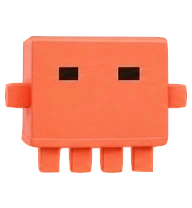
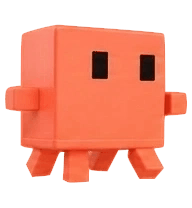
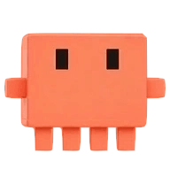

# 小准 · Codex 桌宠

小准是一只橙黄色的方块桌宠：黑色矩形眼睛、两只短手和四条短腿。这里公开的是可安装的 Codex 自定义桌宠素材包，不包含 Photoshop 工程文件或生成过程素材。

## 预览

以下预览均从仓库中的 `spritesheet.webp` 提取，不使用旧版预览素材。

| 待机 | 拖动 | 挥手 |
|:---:|:---:|:---:|
|  |  |  |

## 安装

下载仓库后，将整个 `xiaozhun` 文件夹复制到 Codex 的 `pets` 目录，使文件结构为：

```text
<Codex 配置目录>/pets/xiaozhun/pet.json
<Codex 配置目录>/pets/xiaozhun/spritesheet.webp
```

Windows 默认配置目录为 `%USERPROFILE%\.codex`。重新启动 Codex，然后在桌宠选择中选“小准”。如果覆盖已有小准，建议先备份原文件夹。

图集是 1536 × 2288 的 8 列 × 11 行 WebP，单格 192 × 208，配置使用 `spriteVersionNumber: 2`。包含待机、左右拖动、招手、跳跃、失败、等待、工作、检查与 16 个注视方向。

## 当前素材说明

此仓库保留了作者在 Photoshop 中编辑后、实际使用的导出版本。该版本可以在作者的 Codex 中显示，但**没有通过严格的图集结构校验**：招手与跳跃行的部分未使用格仍含像素，完全透明区域含非零 RGB。未宣称所有动作或其他 Codex 版本均已验证；如需严格合规的 v2 图集，可在发布副本上重新清理透明数据和未使用格。

小准的形象基于作者提供的参考图，动画图集由 AI 辅助制作，之后由作者编辑。不是 OpenAI 官方桌宠。

## 许可

小准图集及本仓库的文字由 [@eachinqcq](https://github.com/eachinqcq) 以 [Creative Commons Attribution 4.0 International（CC BY 4.0）](LICENSE.md) 授权。使用、分享或修改时请署名“小准 / eachinqcq”，注明所做修改，并附上许可证链接。
